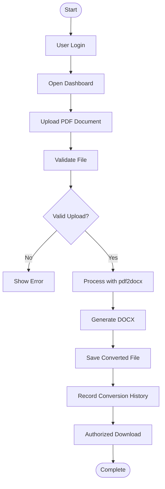
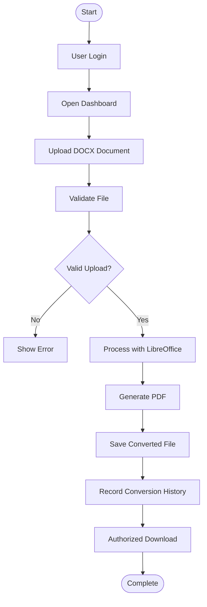
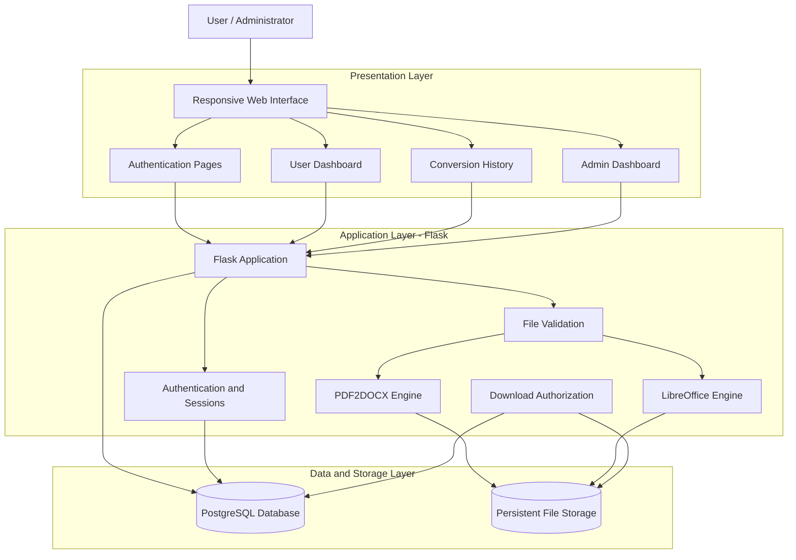
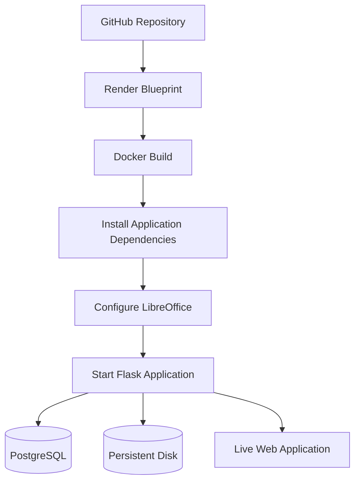

# 📄 DocuFlow — Professional PDF & Word Converter

<p align="center">   <strong>Convert documents. Simplify your workflow.</strong><br/>   A secure, web-based document conversion platform for converting PDF files to editable Word documents and Word documents to PDF. </p>

<p align="center">                      </p>

<p align="center">
  <em>Upload. Convert. Download. All in one place.</em>
</p>

## 📌 About the Project

**DocuFlow** is a web-based document conversion platform developed using Python, Flask, and modern web technologies.

It enables users to convert PDF documents into editable Microsoft Word files and DOCX documents into PDF files through an intuitive browser-based workspace.

Beyond document conversion, DocuFlow provides user authentication, personalized conversion history, private file downloads, and an administrative dashboard.

The application integrates `pdf2docx` for PDF-to-Word conversion and LibreOffice for Word-to-PDF processing.

### Project Highlights

- Full-stack Flask web application.
- Two-way document conversion.
- Individual user accounts and authentication.
- User-specific conversion history.
- Access-controlled document downloads.
- Administrative dashboard.
- PostgreSQL database configuration for deployment.
- Docker-based deployment support.
- Render hosting configuration.

## ✨ Core Features

| Module              | Features                                    |
| ------------------- | ------------------------------------------- |
| Document Conversion | PDF to DOCX and DOCX to PDF                 |
| User Management     | Registration, login, and session management |
| Password Security   | Secure password hashing                     |
| User Workspace      | Document upload and conversion              |
| Conversion History  | Review previous conversion activity         |
| File Management     | Store and download converted documents      |
| Download Security   | Authorization-controlled file access        |
| Admin Dashboard     | Review users and conversion activity        |
| Upload Validation   | File extension validation and 25 MB limit   |
| Responsive UI       | Browser-based responsive interface          |
| Deployment          | Docker and Render Blueprint support         |

## 🔄 Document Conversion Workflows

### 1. PDF to Word

Convert PDF documents into editable DOCX files using the `pdf2docx` processing library.



### 2. Word to PDF

Convert DOCX documents into PDF files using LibreOffice in headless mode.



## 🏗️ System Architecture

DocuFlow follows a client-server architecture in which the Flask backend manages authentication, document processing, database operations, and file access.



## 🛠️ Technology Stack

| Category             | Technologies                     |
| -------------------- | -------------------------------- |
| Programming Language | Python 3.11+                     |
| Backend Framework    | Flask                            |
| Frontend             | HTML5, CSS3, JavaScript          |
| PDF Processing       | pdf2docx                         |
| Word Processing      | LibreOffice                      |
| Production Database  | PostgreSQL                       |
| Local Database       | Configured local database        |
| Authentication       | Flask Sessions, Password Hashing |
| Containerization     | Docker                           |
| Deployment Platform  | Render                           |
| Persistent Storage   | Render Persistent Disk           |

## 🔐 Authentication & Access Management

DocuFlow provides separate access experiences for regular users and administrators.

### User Account Features

- Create a new account.
- Log in using registered credentials.
- Maintain authenticated sessions.
- Access the document conversion workspace.
- Review personal conversion history.
- Download authorized conversion results.

### Administrator Features

- Access the administrative dashboard.
- Review registered users.
- Monitor document conversion activity.

### Access Levels

| User Role     | Access                                                          |
| ------------- | --------------------------------------------------------------- |
| Regular User  | Upload, convert, download, and view personal history            |
| Administrator | Access administrative dashboard and review application activity |

### Administrator Configuration

The initial administrator account is configured through environment variables:

```env
ADMIN_USERNAME=admin
ADMIN_PASSWORD=your-strong-password
```

**Important:** The initial administrator is created using the configured credentials. Changing these environment variables after account creation does not automatically reset or rename the existing account.

## 📂 Supported Document Formats

| Input Document | Converted Document | Processing Engine |
| -------------- | ------------------ | ----------------- |
| PDF            | DOCX               | pdf2docx          |
| DOCX           | PDF                | LibreOffice       |

### Upload Restrictions

| Validation         | Configuration        |
| ------------------ | -------------------- |
| Maximum file size  | 25 MB                |
| PDF extension      | `.pdf`               |
| Word extension     | `.docx`              |
| Legacy Word format | `.doc` not supported |

## 📁 Project Structure

The following is an illustrative overview of the documented application components. Adjust it to match the actual repository structure.

```text
DocuFlow/
│
├── app.py
├── requirements.txt
├── Dockerfile
├── render.yaml
│
├── templates/
│   ├── index.html
│   ├── login.html
│   ├── register.html
│   ├── dashboard.html
│   └── admin.html
│
├── static/
│   ├── css/
│   ├── js/
│   └── images/
│
├── storage/
│   ├── uploads/
│   └── converted/
│
└── README.md
```

## 🚀 Installation & Local Setup

Follow these steps to run DocuFlow locally.

### Prerequisites

- Python 3.11 or newer
- pip
- Git
- LibreOffice
- VS Code (recommended)

### Step 1 — Install LibreOffice

For macOS users:

```bash
brew install --cask libreoffice
```

### Step 2 — Clone the Repository

```bash
git clone <YOUR_GITHUB_REPOSITORY_URL>
cd DocuFlow
```

### Step 3 — Create a Virtual Environment

```bash
python3 -m venv .venv
```

### Step 4 — Activate the Environment

```bash
source .venv/bin/activate
```

### Step 5 — Install Dependencies

```bash
pip install -r requirements.txt
```

### Step 6 — Configure Environment Variables

```bash
export SECRET_KEY='your-long-random-secret'
export ADMIN_USERNAME='admin'
export ADMIN_PASSWORD='your-strong-password'
```

Never upload real credentials or secret keys to a public repository.

### Step 7 — Run the Application

```bash
python app.py
```

### Step 8 — Access the Website

Open your browser and visit:

```text
http://127.0.0.1:5000
```

You can now register, log in, upload documents, convert files, and download the results.

## ☁️ Production Deployment — Render

DocuFlow supports deployment through its Dockerfile and `render.yaml` Blueprint configuration.

### Deployment Workflow



### Deployment Steps

1. Push your project to GitHub.
2. Log in to [Render](https://render.com/).
3. Select **New → Blueprint**.
4. Connect your GitHub repository.
5. Apply the supplied `render.yaml`.
6. Configure the required `ADMIN_PASSWORD` secret.
7. Allow Render to provision the PostgreSQL database and persistent disk.
8. Wait for the Docker build and deployment to complete.
9. Open your generated Render application URL.

### Render Configuration

| Component          | Deployment Configuration      |
| ------------------ | ----------------------------- |
| Hosting            | Render Web Service            |
| Runtime            | Docker                        |
| Database           | Render PostgreSQL             |
| Storage            | Persistent Disk               |
| Storage Mount      | `/app/storage`                |
| PDF Conversion     | pdf2docx                      |
| Word Conversion    | LibreOffice                   |
| Application Secret | Render-generated `SECRET_KEY` |

### Environment Variables

| Variable               | Purpose                        |
| ---------------------- | ------------------------------ |
| `SECRET_KEY`           | Flask session security         |
| `ADMIN_USERNAME`       | Initial administrator username |
| `ADMIN_PASSWORD`       | Initial administrator password |
| Database configuration | PostgreSQL connection settings |

Keep production secrets private and configure them through the hosting platform.

## ⚠️ Known Limitations

Document conversion quality depends on the original document's formatting and structure.

- Complex PDF layouts may not be reproduced perfectly in Word.
- Tables, columns, fonts, and spacing may change during conversion.
- Scanned PDFs require OCR, which is not included.
- DOCX-to-PDF rendering may differ slightly from Microsoft Word.
- Legacy `.doc` files are not supported.
- The maximum upload size is 25 MB.

## 🔒 Security & Production Readiness

The application includes authentication, password hashing, and access-controlled downloads. Further protections should be considered before broad public deployment.

| Area               | Recommended Improvement                          |
| ------------------ | ------------------------------------------------ |
| CSRF               | Add CSRF token validation                        |
| Authentication     | Implement login rate limiting                    |
| File Uploads       | Strengthen MIME-type and content validation      |
| Malware Protection | Scan uploaded documents                          |
| File Management    | Add automatic retention and cleanup              |
| Database           | Configure regular backups                        |
| Sessions           | Configure secure cookies and expiration          |
| Scalability        | Use shared object storage for multiple instances |

**Storage consideration:** A persistent disk is attached to its configured Render service. If the application is scaled across multiple instances, consider shared object storage instead of relying on instance-local files.

## 🔮 Future Development Roadmap

Potential enhancements for future versions:

- [ ] OCR support for scanned PDF documents.
- [ ] Batch document conversion.
- [ ] Drag-and-drop file uploads.
- [ ] Document preview functionality.
- [ ] Real-time conversion progress.
- [ ] Additional document formats.
- [ ] Cloud object storage integration.
- [ ] Email notifications.
- [ ] User storage quotas.
- [ ] Advanced administrative analytics.
- [ ] Subscription plans and usage limits.

*Roadmap items are planned enhancements and are not represented as currently implemented features.*

## 🎓 Learning Outcomes

This project demonstrates practical implementation of:

- Python and Flask web development.
- Full-stack application architecture.
- User authentication and session management.
- Password hashing and access control.
- PDF and Word document processing.
- Third-party software integration.
- File upload and download management.
- Database integration.
- Administrative dashboard development.
- Docker containerization.
- Cloud deployment using Render.
- Persistent file storage configuration.

## 👨‍💻 About the Developer

\<p align="center">   \   \<br/>\<br/>   \<strong>Lakshya Kansal\</strong>   \<br/>   Full-Stack Developer | MCA Student | Software Development Enthusiast   \<br/>\<br/>   Passionate about building practical, user-focused applications by combining backend engineering, modern web technologies, database management, and AI-driven solutions. \</p>

### Technical Expertise

\<p align="center">   \   \   \   \   \   \   \   \   \ \</p>


