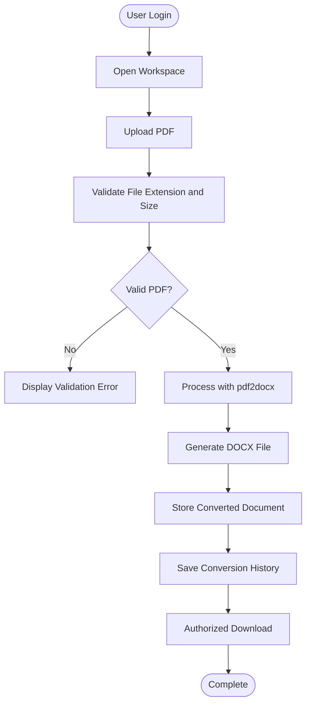
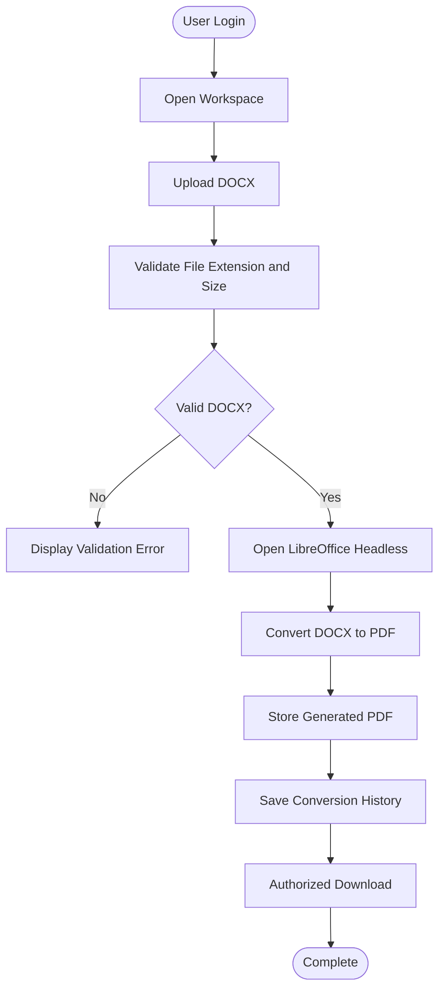
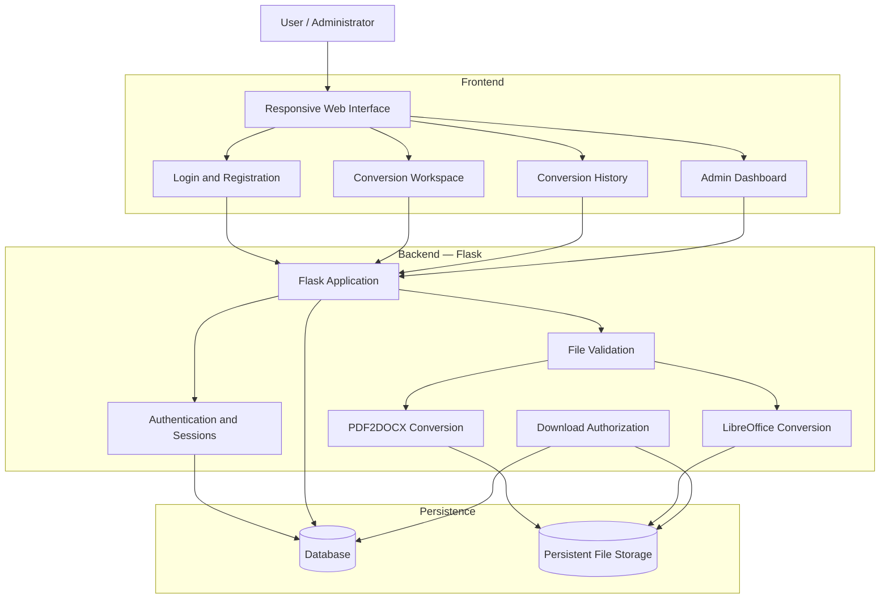
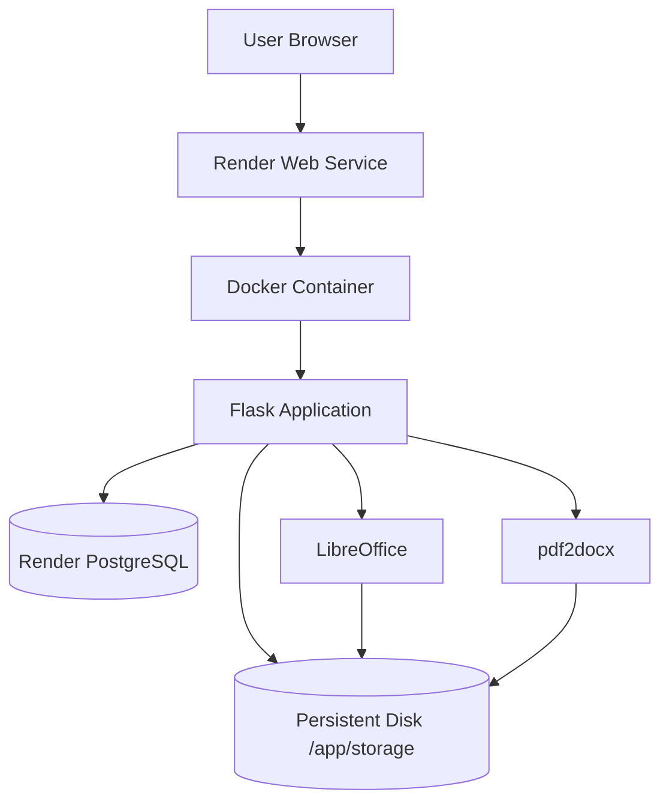

# 📄 DocuFlow — PDF & Word Converter

\<p align="center">   \<strong>Convert documents effortlessly. Manage files securely. Work smarter.\</strong>   \<br/>   A full-stack document conversion platform built with Python, Flask, PDF2DOCX, and LibreOffice. \</p>

\<p align="center">   \   \   \   \   \   \ \</p>

---

## 📖 Project Overview

**DocuFlow** is a web-based document conversion platform that allows users to convert PDF files into editable Microsoft Word documents and Word documents into PDF files.

The application provides a centralized workspace where registered users can upload documents, perform conversions, download results, and review their conversion history.

It also includes an administrative dashboard for managing users and monitoring document conversion activity.

Built using **Python and Flask**, DocuFlow integrates `pdf2docx` for PDF-to-Word conversion and headless LibreOffice for Word-to-PDF conversion.

### 🎯 Project Objectives

- Simplify PDF and Word document conversion.
- Provide a convenient online document workspace.
- Support PDF-to-editable-DOCX conversion.
- Support DOCX-to-PDF conversion.
- Implement user registration and authentication.
- Maintain private, user-specific conversion history.
- Provide secure access-controlled downloads.
- Build an administrative dashboard.
- Support persistent file storage and database-backed deployment.

---

## ✨ Key Features

| Feature              | Description                                           |
| -------------------- | ----------------------------------------------------- |
| PDF to Word          | Convert PDF files into editable DOCX documents        |
| Word to PDF          | Convert DOCX files into PDF documents                 |
| User Registration    | Create individual user accounts                       |
| Secure Login         | Authenticate users with hashed passwords              |
| Session Management   | Maintain authenticated user sessions                  |
| Conversion History   | View previously completed conversions                 |
| Private Downloads    | Restrict conversion downloads to authorized users     |
| Admin Dashboard      | Monitor users and conversion activity                 |
| Upload Validation    | Validate supported file extensions                    |
| File Size Limit      | Maximum upload size of 25 MB                          |
| Responsive Interface | Workspace and landing page for different screen sizes |
| Persistent Storage   | Preserve converted files using persistent storage     |
| Docker Support       | Containerized application deployment                  |
| Render Blueprint     | Deployment configuration using `render.yaml`          |

---

## 🔄 Document Conversion Workflow

DocuFlow supports two conversion directions.

### 1. PDF to Word Conversion

PDF files are processed using the `pdf2docx` library to produce editable DOCX documents.



### 2. Word to PDF Conversion

DOCX files are converted using LibreOffice in headless mode.



---

## 🏗️ System Architecture

DocuFlow follows a Flask-based client-server architecture.



### Architecture Components

| Component                  | Technology                         | Responsibility                         |
| -------------------------- | ---------------------------------- | -------------------------------------- |
| Frontend                   | HTML, CSS, JavaScript              | User interface                         |
| Backend                    | Flask                              | Request handling and application logic |
| Authentication             | Flask session-based authentication | User login and access control          |
| Password Security          | Password hashing                   | Secure password storage                |
| PDF Processing             | `pdf2docx`                         | PDF-to-DOCX conversion                 |
| Word Processing            | LibreOffice                        | DOCX-to-PDF conversion                 |
| Database                   | PostgreSQL on Render               | Persistent application records         |
| Local Development Database | Configured local database          | Local development                      |
| File Storage               | Persistent disk                    | Store converted documents              |
| Containerization           | Docker                             | Application packaging                  |
| Hosting                    | Render                             | Application deployment                 |

---

## 🔐 Authentication and User Management

DocuFlow includes registration, login, and session-based authentication.

### User authentication features

- New users can register for an account.
- Passwords are stored using secure password hashing.
- Registered users can sign in.
- Authenticated sessions provide access to the conversion workspace.
- Users can review their own conversion history.
- Download access is checked against user authorization.

### User access levels

| Role          | Permissions                                                      |
| ------------- | ---------------------------------------------------------------- |
| Regular User  | Upload, convert, download, and view personal conversion history  |
| Administrator | Access administrative dashboard and review users and conversions |

### Admin account configuration

The initial administrator account is created using:

```env
ADMIN_USERNAME=admin
ADMIN_PASSWORD=your-strong-password
```

**Important:** The administrator account is created on the first launch using the configured credentials. Changing the environment variables after the account already exists does not automatically rename or reset that account.

---

## 📂 File Validation and Storage

DocuFlow validates uploaded documents before processing.

### Supported file formats

| Input Format | Output Format | Conversion Engine |
| ------------ | ------------- | ----------------- |
| PDF          | DOCX          | `pdf2docx`        |
| DOCX         | PDF           | LibreOffice       |

### Upload restrictions

| Validation          | Configuration        |
| ------------------- | -------------------- |
| Maximum upload size | 25 MB                |
| PDF input           | `.pdf`               |
| Word input          | `.docx`              |
| Legacy Word format  | `.doc` not supported |

### File processing workflow

1. User uploads a document.
2. The application validates the extension and upload size.
3. The selected conversion engine processes the document.
4. The generated file is stored.
5. Conversion history is recorded.
6. The authorized user downloads the result.

### Private download access

Converted files are not intended to be publicly accessible.

The application checks user authorization before allowing downloads, helping prevent users from accessing other users' conversion results.

---

## 📁 Project Structure

The complete directory structure should be aligned with the actual repository. The following is a high-level structure of the application components.

```text
DocuFlow/
│
├── app.py
├── requirements.txt
├── Dockerfile
├── render.yaml
│
├── storage/
│   ├── uploads/
│   └── converted/
│
├── templates/
│   ├── index.html
│   ├── login.html
│   ├── register.html
│   ├── dashboard.html
│   └── admin.html
│
└── static/
    ├── css/
    ├── js/
    └── images/
```

*Note: This is an illustrative organization of the documented application components, not a verified listing of every repository file.*

---

## 🛠️ Technology Stack

| Technology                         | Purpose                                                   |
| ---------------------------------- | --------------------------------------------------------- |
| Python 3.11+                       | Backend programming language                              |
| Flask                              | Web application framework                                 |
| `pdf2docx`                         | PDF-to-Word conversion                                    |
| LibreOffice                        | Word-to-PDF conversion                                    |
| PostgreSQL                         | Production database                                       |
| SQLite / Configured Local Database | Local development, depending on application configuration |
| HTML5                              | Page structure                                            |
| CSS3                               | Styling and responsive layouts                            |
| JavaScript                         | Frontend interactions                                     |
| Docker                             | Containerization                                          |
| Gunicorn / Render Configuration    | Production application serving                            |
| Render                             | Application hosting and deployment                        |

---

## 🚀 Run Locally on macOS

### Prerequisites

Install the following:

| Requirement | Version / Purpose         |
| ----------- | ------------------------- |
| Python      | 3.11 or newer             |
| pip         | Python package management |
| LibreOffice | DOCX-to-PDF conversion    |
| Git         | Repository management     |
| VS Code     | Recommended code editor   |

### 1. Install LibreOffice

On macOS, use Homebrew:

```bash
brew install --cask libreoffice
```

Ensure LibreOffice is installed correctly before testing Word-to-PDF conversion.

### 2. Clone the repository

```bash
git clone <YOUR_GITHUB_REPOSITORY_URL>
cd DocuFlow
```

### 3. Create a virtual environment

```bash
python3 -m venv .venv
```

### 4. Activate the virtual environment

```bash
source .venv/bin/activate
```

### 5. Install dependencies

```bash
pip install -r requirements.txt
```

### 6. Configure environment variables

```bash
export SECRET_KEY='replace-with-a-long-random-secret'
export ADMIN_USERNAME='admin'
export ADMIN_PASSWORD='use-a-strong-password'
```

Never use weak or publicly shared credentials.

### 7. Start the application

```bash
python app.py
```

### 8. Open DocuFlow

Visit:

```text
http://127.0.0.1:5000
```

You can now register an account, upload documents, perform conversions, and download generated files.

---

## ☁️ Deploy to Render

DocuFlow supports deployment through the supplied `render.yaml` Blueprint and Dockerfile.

### Deployment architecture



### Deployment steps

1. Push the complete project to a GitHub repository.
2. Sign in to Render.
3. Select **New → Blueprint**.
4. Connect your GitHub repository.
5. Apply the supplied `render.yaml`.
6. Provide the required `ADMIN_PASSWORD` secret when prompted.
7. Allow Render to provision the PostgreSQL database and persistent disk.
8. Wait for the Docker image to build and the service to deploy.
9. Open the generated Render URL.
10. Sign in using the configured administrator credentials.

### Render infrastructure

| Component              | Configuration                              |
| ---------------------- | ------------------------------------------ |
| Application            | Render Web Service                         |
| Deployment             | Dockerfile                                 |
| Database               | Render PostgreSQL                          |
| Persistent Storage     | Disk mounted at `/app/storage`             |
| Document Conversion    | LibreOffice installed in Docker image      |
| Application Secret     | Render-generated `SECRET_KEY`              |
| Administrator Password | Supplied through environment configuration |

### Important environment variables

| Variable               | Purpose                        |
| ---------------------- | ------------------------------ |
| `SECRET_KEY`           | Flask session security         |
| `ADMIN_USERNAME`       | Initial administrator username |
| `ADMIN_PASSWORD`       | Initial administrator password |
| Database configuration | PostgreSQL connection settings |

Keep all production credentials private.

---

## 🐳 Docker Support

The project includes a Dockerfile that packages the application and its document conversion dependencies.

LibreOffice is installed in the container to support DOCX-to-PDF conversion.

Docker helps maintain a consistent runtime environment between deployment and local container testing.

For local container testing, use the project's actual Docker configuration and required environment variables.

---

## ⚠️ Conversion Limitations

Document conversion quality depends on the structure and content of the source file.

### PDF to Word

- PDF-to-DOCX layout fidelity varies.
- Complex tables and columns may not convert perfectly.
- Some fonts and formatting may change.
- Scanned or image-only PDFs require OCR.
- OCR is not included in this starter.

### Word to PDF

- DOCX files are converted using headless LibreOffice.
- Rendering can differ slightly from Microsoft Word.
- Fonts and page layout may vary depending on the installed environment.

### Supported formats

- PDF input.
- DOCX input.
- DOCX output.
- PDF output.

Legacy `.doc` files are not supported.

---

## 🔒 Security and Production Considerations

DocuFlow includes important security foundations, but additional protections should be implemented before broad public use.

| Area                   | Recommendation                                                |
| ---------------------- | ------------------------------------------------------------- |
| Password Security      | Continue using secure password hashing                        |
| Session Security       | Use secure cookie settings and appropriate session expiration |
| Application Secret     | Use a long, randomly generated `SECRET_KEY`                   |
| Administrator Account  | Use unique, strong administrator credentials                  |
| CSRF Protection        | Add CSRF tokens to state-changing forms                       |
| Upload Validation      | Strengthen file content and MIME-type validation              |
| Malware Protection     | Scan uploaded documents before processing                     |
| File Privacy           | Keep converted documents private                              |
| Download Authorization | Verify ownership on every download request                    |
| Rate Limiting          | Limit login and upload attempts                               |
| Storage Management     | Implement scheduled cleanup and retention policies            |
| Database Protection    | Configure backups and secure credentials                      |
| Transport Security     | Enforce HTTPS in production                                   |

### Multi-instance deployment

The supplied deployment uses a persistent disk for converted files.

If the application is scaled to multiple instances, local persistent storage may not be shared across all instances.

For a multi-instance architecture:

- Move documents to shared object storage.
- Use a shared database.
- Centralize file access and authorization.
- Implement retention and cleanup policies.

---

## 🔮 Future Enhancements

Potential improvements include:

- OCR support for scanned PDFs.
- Batch document conversion.
- Drag-and-drop upload.
- Document preview before downloading.
- Conversion progress indicators.
- More advanced DOCX formatting preservation.
- Additional supported document formats.
- Cloud object storage integration.
- Scheduled file cleanup.
- Email notifications after conversion.
- User storage quotas.
- Admin conversion analytics.
- Subscription plans and usage limits.
- Document conversion API for external applications.

These are proposed enhancements, not claims about currently implemented functionality.

---

## 📚 Learning Outcomes

This project demonstrates practical experience with:

- Python web development.
- Flask application architecture.
- User authentication and session management.
- Secure password hashing.
- PDF and Word document processing.
- Integration with external system software.
- File upload and download handling.
- User-specific data access.
- Administrative dashboard development.
- Database-backed application development.
- Docker containerization.
- Persistent storage configuration.
- Render Blueprint deployment.
- Application security and production planning.

---

## 👨‍💻 Developer

**Developed by Lakshya Kansal**

DocuFlow is a document-conversion platform designed to make everyday PDF and Word file operations easier through a secure, browser-based workspace.

\<p align="center">
&#x20; \<strong>📄 Convert. Download. Manage.\</strong>
&#x20; \<br/>
&#x20; \<em>DocuFlow — Your Documents, Simplified.\</em>
\</p>
