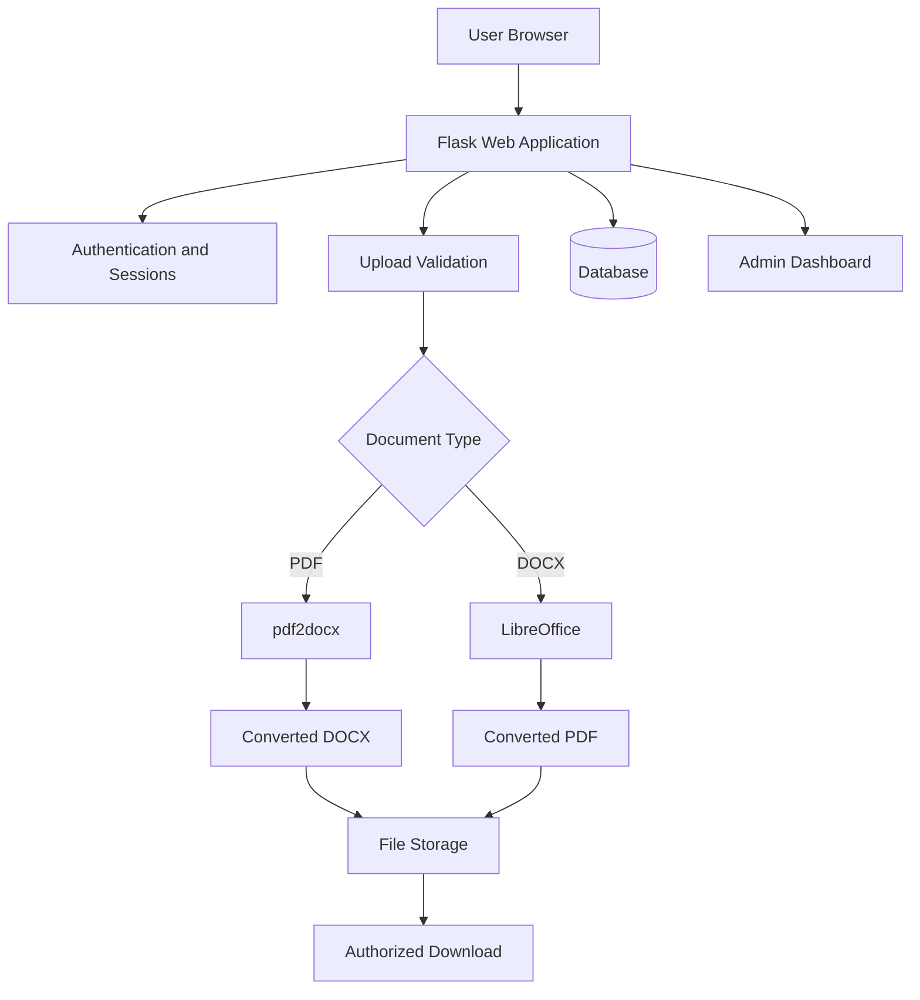

# 📄 DocuFlow — PDF & Word Converter

<p align="center">
  <strong>Convert documents. Simplify your workflow.</strong><br/>
  A secure, web-based document conversion platform for converting PDF files to editable Word documents and Word documents to PDF.
</p>

<p align="center">
  
  
  
  
  
  
  
</p>

<p align="center">
  <em>Upload. Convert. Download. All in one place.</em>
</p>

---

## 📌 Overview

**DocuFlow** is a full-stack document conversion application developed using Python and Flask. It provides an online workspace for converting PDF documents into editable Microsoft Word files and DOCX documents into PDF files.

The platform combines document processing, user authentication, private downloads, conversion history, and administrative management in one application.

### Conversion Capabilities

| Conversion | Technology |
|---|---|
| PDF → Word (.docx) | `pdf2docx` |
| Word (.docx) → PDF | LibreOffice |

## ✨ Key Features

- **Two-way document conversion** — Convert PDF to DOCX and DOCX to PDF.
- **User registration** — Create individual user accounts.
- **Secure authentication** — Login with password hashing and session management.
- **Personal workspace** — Access document conversion functionality after login.
- **Conversion history** — Review previous conversion activity.
- **Private downloads** — Restrict downloads to authorized users.
- **Admin dashboard** — Review registered users and conversion activity.
- **Upload validation** — Validate supported file extensions.
- **25 MB upload limit** — Restrict the maximum uploaded file size.
- **Persistent storage** — Preserve files using configured persistent storage.
- **Responsive interface** — Designed for different screen sizes.
- **Docker support** — Containerized deployment configuration.
- **Render Blueprint** — Deployment using the included `render.yaml`.

## 🏗️ Project Architecture



## 🛠️ Technology Stack

| Layer | Technology |
|---|---|
| Backend | Python 3.11+, Flask |
| Frontend | HTML, CSS, JavaScript |
| PDF conversion | `pdf2docx` |
| Word conversion | LibreOffice |
| Production database | PostgreSQL |
| Local database | Configured local database |
| Authentication | Flask sessions and password hashing |
| Containerization | Docker |
| Hosting | Render |
| File storage | Render Persistent Disk |

## 🚀 Getting Started

### Prerequisites

- Python 3.11 or later
- pip
- Git
- LibreOffice
- VS Code (recommended)

### 1. Install LibreOffice on macOS

```bash
brew install --cask libreoffice
```

### 2. Clone the Repository

```bash
git clone <YOUR_GITHUB_REPOSITORY_URL>
cd DocuFlow
```

### 3. Create a Virtual Environment

```bash
python3 -m venv .venv
```

### 4. Activate the Virtual Environment

```bash
source .venv/bin/activate
```

### 5. Install Dependencies

```bash
pip install -r requirements.txt
```

### 6. Configure Environment Variables

```bash
export SECRET_KEY='replace-with-a-long-random-secret'
export ADMIN_USERNAME='admin'
export ADMIN_PASSWORD='use-a-strong-password'
```

Use unique credentials and never commit secrets to GitHub.

### 7. Start the Application

```bash
python app.py
```

### 8. Open DocuFlow

Visit:

```text
http://127.0.0.1:5000
```

You can now register an account, upload documents, perform conversions, and download the generated files.

## ☁️ Deployment on Render

DocuFlow includes a Dockerfile and Render Blueprint configuration.

### Deployment Steps

1. Push the complete project to GitHub.
2. Log in to [Render](https://render.com/).
3. Select **New → Blueprint**.
4. Connect your GitHub repository.
5. Apply the supplied `render.yaml`.
6. Set the required `ADMIN_PASSWORD` secret.
7. Allow Render to provision the configured PostgreSQL database and persistent disk.
8. Wait for the deployment to finish.
9. Open the generated application URL.

### Deployment Configuration

| Component | Configuration |
|---|---|
| Web service | Render |
| Runtime | Docker |
| Database | Render PostgreSQL |
| File storage | Persistent disk mounted at `/app/storage` |
| PDF conversion | `pdf2docx` |
| DOCX conversion | LibreOffice |
| Application secret | Render-generated `SECRET_KEY` |

**Administrator account:** The initial administrator is created using the configured environment variables. Changing those variables after the account already exists does not automatically reset or rename that account.

## ⚠️ Important Limitations

- PDF-to-Word formatting accuracy depends on the source PDF.
- Complex layouts, tables, and fonts may not be reproduced perfectly.
- Scanned PDFs require OCR; OCR is not included.
- DOCX-to-PDF rendering may differ slightly from Microsoft Word.
- Legacy `.doc` files are not supported.
- The maximum upload size is 25 MB.

## 🔒 Security and Production Considerations

Before broad public use, consider implementing:

- CSRF protection.
- Login and upload rate limiting.
- Malware scanning for uploaded documents.
- Stronger file content and MIME-type validation.
- Automatic file retention and cleanup.
- Database backup procedures.
- Secure cookie configuration.
- Shared object storage for multi-instance deployments.

## 🔮 Planned Enhancements

- OCR support for scanned PDFs.
- Batch document conversion.
- Drag-and-drop uploads.
- Document preview.
- Conversion progress indicators.
- Additional document formats.
- Cloud object storage integration.
- Email notifications.
- Usage limits and subscription plans.

*These are proposed enhancements, not currently implemented features.*

## 👨‍💻 Developer

**Lakshya Kansal**

DocuFlow is a full-stack project demonstrating document processing, Flask application development, authentication, database integration, file management, and cloud deployment.

<p align="center">
  <strong>DOCUFLOW</strong><br/>
  <em>Your documents. Your workflow. Simplified.</em>
</p>
